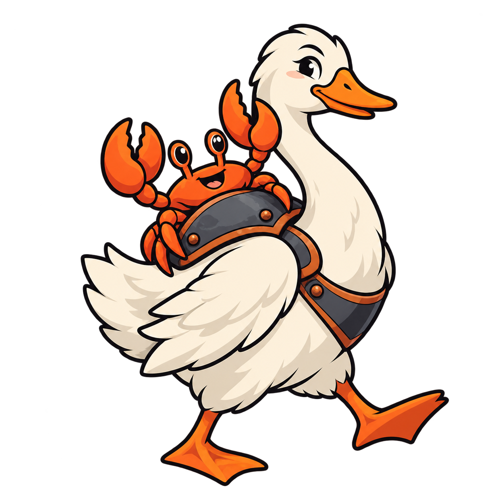

# Ferrous Goose

<p align="center">
  
</p>

Call Rust crates from Goose, or embed Goose in Rust, using generated
bindings. User code needs no C wrappers, headers or unsafe Rust.

A Rust crate exports its API with attributes:

```rust
#[goose::handle]
pub struct Regex(regex::Regex);

#[goose::export]
pub fn compile(pattern: &str) -> Result<Regex, regex::Error> {
    regex::Regex::new(pattern).map(Regex)
}

#[goose::export]
pub fn find<'t>(re: &Regex, text: &'t str) -> Option<&'t str> {
    re.0.find(text).map(|m| m.as_str())
}
```

`cargo goose` generates a module in the crate's configured namespace
(`rx` in this example). Goose imports it:

```goose
import rx;

fn main() {
    let re, ok = rx::compile("[0-9]+");
    assert(ok);
    let hit, found = rx::find(re, "order 1001 shipped");
    if found { print(hit); }
    rx::release(re);
}
```

The match is a view into the input text. Rust-owned objects stay behind
handles, which Goose releases explicitly.

To call Goose from Rust, compile it in `build.rs`:

```rust
// build.rs
fn main() { goose_build::Program::new("goose/kernels.goose").compile().unwrap(); }

// src/main.rs
goose::include!(kernels);
fn main() {
    let rt = goose::Runtime::init().unwrap();
    println!("{} words", kernels::count_words(&rt, b"count these words"));
}
```

## Getting started

From this checkout:

```sh
scripts/toolchain.sh
cargo install --path crates/cargo-goose
cargo goose run examples/regex/goose/find_emails.goose --manifest-path examples/regex/rust/Cargo.toml
```

The toolchain script applies [eight compiler patches](docs/goose-patches.md)
to Goose commit `e76d5c9f7f0a17d83c12a405fbb2513094d03985` and builds
`.toolchain/goose/build/goose`. Use `--stock` to build that commit without
patches. `GOOSE_REPO=/path/to/goose` selects a local clone source.

`cargo goose` finds the compiler through `--goose`, `$GOOSE`, a
`.toolchain/goose/build/goose` above the current directory, or PATH.
Ordinary bindings support the stock compiler; features that need a patch
are [listed separately](docs/goose-patches.md).

For your own crate, use `crate-type = ["cdylib"]` and mark its API with the
attributes above. Common commands are:

```sh
cargo goose bindings -o ns.goose
cargo goose run goose/main.goose
cargo goose build goose/main.goose
cargo goose test
```

`cargo goose new <path>` creates a crate, Goose example and test.

## Build integration and packages

With the patched compiler, a `.build` sidecar can invoke the Rust provider:

```goose
// find_emails.build
native_build = ["cargo-goose", "native", "--manifest-path", "../rust/Cargo.toml"];
```

The command runs from the package directory and requires `cargo-goose` on
PATH. Add `staticlib` to the crate types; multi-crate builds also need
`rlib`. `goose run` and `goose build` then build the crate and generate its
module automatically. The [native-build protocol](docs/goose-patches.md#external-native-builders)
also supports providers for other languages.

To distribute a module with prebuilt libraries:

```sh
cargo goose package dist --targets aarch64-apple-darwin,x86_64-apple-darwin,x86_64-unknown-linux-gnu,x86_64-pc-windows-gnu --zig
```

Users of the resulting package need Goose but no Rust toolchain. Packages
that expose strict `zero_copy` exports currently support host-target builds
only.

## Copy policy and callbacks

Ordinary exports borrow compatible memory and copy when layout, alignment
or ownership requires it. `#[goose::export(zero_copy)]` rejects signatures
that require payload copies and fails misaligned borrows. It requires
compiler layout verification and retains safety checks. See the
[copy contract](docs/performance.md) for supported types and limits.

Rust can call Goose exports during a native call using `goose::callbacks!`
and `&goose::Reentry`. Closure-style callbacks use coroutines and also work
with stock Goose. See [callbacks](docs/design.md#callbacks).

## Repository

| Path | Contents |
|---|---|
| [crates/goose](crates/goose) | Argument validation, builders, handles, panic handling and embedding runtime |
| [crates/goose-macros](crates/goose-macros) | Export, handle and flat-type macros |
| [crates/cargo-goose](crates/cargo-goose) | Binding generation, builds, tests and packaging |
| [crates/goose-build](crates/goose-build) | Goose compilation and Rust binding generation for `build.rs` |
| [goose-patches](goose-patches) | Compiler and runtime patches |
| [conformance](conformance) | Interoperability and rejection tests in both directions |
| [examples](examples) | Regex, shapes, multiple crates and embedding |
| [packages](packages) | Package sources for regex, JSON, images and SQLite |
| [bench](bench) | Boundary-cost benchmarks and recorded results |
| [docs](docs) | [Architecture](docs/design.md), [type map](docs/type-map.md) and [validation status](docs/phases.md) |

## Testing

Build both compilers, then run the checks:

```sh
scripts/toolchain.sh --stock
scripts/check.sh
```

The script runs workspace tests, conformance, examples and native-provider
checks against both compilers, plus any built package examples. Use
`SKIP_PACKAGES=1` to skip package examples. Run `bench/run.sh` separately for
latency measurements.

The current implementation was validated on macOS arm64. Earlier revisions
also ran on Linux arm64. See [validation status](docs/phases.md#where-it-has-run)
for coverage and untested platforms.
